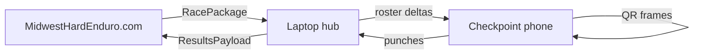

# Architecture

Three pieces talk to each other on race day. None of them need a network except when the laptop downloads the race package before the event and publishes results after it.

## Laptop

Windows app, Tauri 2 + React. It is the only place that edits start times, penalties, DQs, and published results. Every manual add, delete, or change writes a `ChangelogEntry`.

Later phases add:

- SQLite for the race-day database
- an embedded HTTP server (Rust / axum) that phones sync with on the local network

Phase 0 only builds the Vite bundle and links it to `@mwhe/core`. `apps/laptop/src-tauri` is the Tauri scaffold. It is not compiled in CI.

## Station

Android only, Capacitor + React. A phone is locked to one check at setup. It holds a minimal roster: name, number, and class. Punches use the phone's GPS-set clock. There is no central clock.

If a phone cannot reach the laptop, it exports punches as QR frames another phone or the laptop can import.

Phase 0 builds the web bundle. The Android project is not generated. See [release.md](release.md).

## Core

`packages/core` is pure TypeScript. It does not read the clock, the disk, or the network. Callers pass the race package, punches, start times, penalties, and DQs. `scoreRace` returns a `ResultsPayload` plus warnings.

`schemaVersion` is `1` on every persisted document. Bump it when a document shape changes in a breaking way. The git tag is a separate version. See [release.md](release.md).

## Time

Each phone stamps punches from its own GPS-set clock. The laptop stores those timestamps as-is. Total time for a rider is the last valid punch minus that rider's start, plus penalties. Riders do not share a start instant unless the laptop sets them that way.
