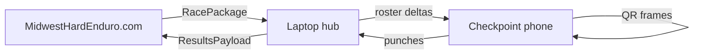

# Architecture

Three pieces talk to each other on race day. None of them need a network except when the laptop downloads the race package before the event and publishes results after it.

## Laptop

Windows app, Tauri 2 + React. It is the only place that edits start times, penalties, DQs, and published results. Every manual add, delete, or change writes a `ChangelogEntry`.

Phase 1 stores the race in SQLite and talks to the site for the race package:

- SQLite is the source of truth. The browser preview uses sql.js and flushes the file to IndexedDB after each save. The Tauri shell uses `tauri-plugin-sql` (`sqlite:mwhe-hub.db`). Migrations live in `apps/laptop/src/db/migrations.ts` and run from TypeScript, so the same SQL is what the tests apply.
- Sign-in is the person's MidwestHardEnduro.com email and password, or Google sign-in on the website. The packaged app uses app id `6aa2c672e73573140bed9035` and `https://midwesthardenduro.com`. Nobody types an app id or an event id. Email and password uses Base44's login endpoint. Google opens the site, which redirects a one-time code to `127.0.0.1`; the laptop exchanges that code for the same kind of access token. The token is never shown and is never put on the loopback URL. Typing the code is only the fallback link. The Tauri shell stores the token with the `keyring` crate (Windows Credential Manager) and listens on `127.0.0.1` for the code for up to 10 minutes. The browser preview keeps the token in memory and can type the code. There is no refresh call. A 401 asks them to sign in again. A race already on the laptop keeps working offline. See [site-api.md](site-api.md).
- After sign-in the laptop lists every event (`listEvents`), imports one, and can re-import it. Re-import adds riders and updates race details when the site's `updatedAt` is newer than the laptop's last edit of that record. Race-day registrations are never removed or overwritten.
- Contact fields are encrypted at rest with AES-256-GCM. The race JSON in SQLite does not contain them. The key is a second Credential Manager entry, `rider-private-key`, and is not cleared on sign-out. SQLCipher was not used because the Tauri shell is not compiled in CI and the browser preview has to run the same code.
- `signInWithPassword`, `exchangeSignInCode`, and `getRacePackage` in `@mwhe/core` are the site client. They take `fetch` so tests can call the mock site, and so the Android app can reuse them. The Tauri shell passes the native HTTP client. The loopback listener that receives the Google code is Rust in `apps/laptop/src-tauri` and is not compiled in CI.

Still later:

- an embedded HTTP server (Rust / axum) that phones sync with on the local network

`apps/laptop/src-tauri` is not compiled in CI. The registration rules, the download client, and the SQLite store are tested in TypeScript. See [release.md](release.md).

## Station

Android only, Capacitor + React. A phone is locked to one check at setup. It holds a minimal roster: name, number, and class. Punches use the phone's GPS-set clock. There is no central clock.

If a phone cannot reach the laptop, it exports punches as QR frames another phone or the laptop can import.

Phase 0 builds the web bundle. The Android project is not generated. See [release.md](release.md).

## Core

`packages/core` is TypeScript. Scoring, registration, and roster deltas do not read the clock, the disk, or the network. Callers pass timestamps, ids, and `fetch`. `scoreRace` returns a `ResultsPayload` plus warnings. `signInWithPassword`, `exchangeSignInCode`, and `getRacePackage` are the site calls, and `startMockSite` is the local stand-in used by tests.

`schemaVersion` is `1` on every persisted document. Bump it when a document shape changes in a breaking way. The git tag is a separate version. See [release.md](release.md).

## Time

Each phone stamps punches from its own GPS-set clock. The laptop stores those timestamps as-is. Total time for a rider is the last valid punch minus that rider's start, plus penalties. Riders on the same start row share that row's clock when the race has a planned start. Row N leaves at the planned start plus the row gap times (N - 1). A start entered on the laptop replaces the row clock for that rider. A timed race counts its limit from the rider's own start. A lap race has no time limit.
