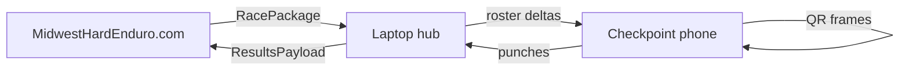

# Architecture

Three pieces talk to each other on race day. None of them need a network except when the laptop downloads the race package before the event and publishes results after it.

## Laptop

Windows app, Tauri 2 + React. It is the only place that edits start times, penalties, DQs, and published results. Every manual add, delete, or change writes a `ChangelogEntry`.

Phase 1 stores the race in SQLite and talks to the site for the race package:

- SQLite is the source of truth. The browser preview uses sql.js and flushes the file to IndexedDB after each save. The Tauri shell uses `tauri-plugin-sql` (`sqlite:mwhe-hub.db`). Migrations live in `apps/laptop/src/db/migrations.ts` and run from TypeScript, so the same SQL is what the tests apply.
- Sign-in is the person's MidwestHardEnduro.com email and password. The laptop calls Base44's login endpoint, keeps that user's access token, and never shows the token. The Tauri shell stores it with the `keyring` crate (Windows Credential Manager). The browser preview keeps it in memory. There is no refresh call. A 401 asks them to sign in again. A race already on the laptop keeps working offline. See [site-api.md](site-api.md).
- `signInWithPassword` and `getRacePackage` in `@mwhe/core` are the site client. They take `fetch` so tests can call the mock site, and so the Android app can reuse them. The Tauri shell passes the native HTTP client.

Still later:

- an embedded HTTP server (Rust / axum) that phones sync with on the local network

`apps/laptop/src-tauri` is not compiled in CI. The registration rules, the download client, and the SQLite store are tested in TypeScript. See [release.md](release.md).

## Station

Android only, Capacitor + React. A phone is locked to one check at setup. It holds a minimal roster: name, number, and class. Punches use the phone's GPS-set clock. There is no central clock.

If a phone cannot reach the laptop, it exports punches as QR frames another phone or the laptop can import.

Phase 0 builds the web bundle. The Android project is not generated. See [release.md](release.md).

## Core

`packages/core` is TypeScript. Scoring, registration, and roster deltas do not read the clock, the disk, or the network. Callers pass timestamps, ids, and `fetch`. `scoreRace` returns a `ResultsPayload` plus warnings. `signInWithPassword` and `getRacePackage` are the site calls, and `startMockSite` is the local stand-in used by tests.

`schemaVersion` is `1` on every persisted document. Bump it when a document shape changes in a breaking way. The git tag is a separate version. See [release.md](release.md).

## Time

Each phone stamps punches from its own GPS-set clock. The laptop stores those timestamps as-is. Total time for a rider is the last valid punch minus that rider's start, plus penalties. Riders do not share a start instant unless the laptop sets them that way.
